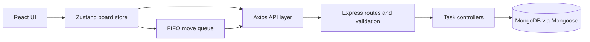

# TaskFlow

TaskFlow is a responsive MERN Kanban board built for the engineering assessment in [`docs/ASSESSMENT.pdf`](docs/ASSESSMENT.pdf). It focuses on immediate client feedback, safe ordering under concurrent moves, accessible light and dark themes, and the selected wildcard: nested checklists with animated task progress.

## Features

- Three task columns: To Do, In Progress, and Done.
- Create, edit, delete, reorder, and move tasks between columns.
- Drag-and-drop with keyboard support and accessible move buttons.
- Optimistic changes with rollback and an error toast when a write fails.
- A FIFO move request queue, version conflict handling, UUID idempotency keys, and transactional order-index rebalancing.
- Optional development switch in the header to simulate failed writes.
- Nested checklist editing and an animated completion progress bar on each card.
- Light and dark themes, persisted across reloads without an initial flash.

## Tech stack

| Area | Technologies |
|---|---|
| Client | React, Vite, Tailwind CSS, Zustand, `@dnd-kit`, axios, `react-hot-toast` |
| Server | Node.js, Express, Mongoose, MongoDB, zod |
| Verification | Node.js `node:test`, Supertest, MongoDB Memory Server, Vitest, ESLint |

All application code is plain JavaScript.

## Architecture



The board store keeps task records keyed by ID and ordered ID lists per column. Move UI changes happen synchronously in the store; the queue serializes only network writes. The server checks task versions and stores operation results transactionally so retries do not apply the same move twice.

### Folder structure

```text
.
+-- client/
|   +-- src/
|   |   +-- api/             # Axios instance and task API functions
|   |   +-- components/      # Board, columns, cards, dialogs, theme control
|   |   +-- hooks/           # Theme and dialog behavior
|   |   +-- store/           # Zustand state and move queue
|   |   +-- utils/           # Client-side fractional ordering
|   +-- .env.example
+-- server/
|   +-- src/
|   |   +-- config/          # Database setup
|   |   +-- controllers/     # Request handlers
|   |   +-- middleware/      # Validation and failure simulation
|   |   +-- models/          # Mongoose models
|   |   +-- routes/          # REST routes
|   |   +-- scripts/         # Seeder
|   |   +-- utils/           # Fractional indexes and async handling
|   +-- scripts/             # Concurrency check
|   +-- test/                # Server unit and API tests
|   +-- .env.example
+-- docs/
|   +-- ASSESSMENT.pdf
|   +-- REQUIREMENTS.md
+-- CONTEXT.md
+-- DECISIONS.md
+-- package.json
```

## Prerequisites

- Node.js 20 LTS or newer and npm.
- MongoDB local or MongoDB Atlas.
- A MongoDB replica set for transactional moves. Atlas clusters support transactions. A local standalone MongoDB does not; configure it as a replica set or move requests return a clear `503` response.

For local development, run MongoDB as a single-node replica set (adapt the data directory to your machine):

```sh
mongod --replSet rs0 --dbpath ./data/db
```

In a second terminal, initialize that replica set once:

```sh
mongosh --eval "rs.initiate()"
```

## Setup and run

Install the root, server, and client dependencies:

```sh
npm install
npm install --prefix server
npm install --prefix client
```

Copy both environment templates, then edit `server/.env` if your MongoDB URI differs from the local default. From PowerShell:

```powershell
Copy-Item server/.env.example server/.env
Copy-Item client/.env.example client/.env
```

From macOS/Linux:

```sh
cp server/.env.example server/.env
cp client/.env.example client/.env
```

Start the API and Vite client together from the repository root:

```sh
npm run dev
```

The API defaults to `http://localhost:5000` and the client to `http://localhost:5173`. Check the API directly at `http://localhost:5000/api/health`.

### Environment variables

`server/.env.example` contains `MONGO_URI`, `PORT`, and `CLIENT_ORIGIN`. `client/.env.example` contains `VITE_API_URL`, including the `/api` prefix. These files contain development defaults only; replace them locally as needed and never put credentials in a committed example file.

## Seed data

Populate all three columns with realistic example tasks, priorities, tags, and partial/complete checklists:

```sh
npm run seed
```

**The seeder deletes every task in the database named by `MONGO_URI` before inserting its sample board. Use a disposable development database.**

## Tests and lint

Run both the server integration/unit tests and the client store tests:

```sh
npm test
```

Run ESLint for both applications:

```sh
npm run lint
```

Build the client for production:

```sh
npm run build --prefix client
```

The server integration suite starts a temporary MongoDB replica set through MongoDB Memory Server. Its first run downloads a large MongoDB test binary. The client Vitest suite tests store transitions and queue ordering without a browser.

## Demo optimistic rollback

1. Start MongoDB and the app with `npm run dev`.
2. In the header, enable **Simulate failure**.
3. Move a card, edit it, or create/delete a task. The UI updates immediately.
4. The server returns a simulated write failure; confirm the task returns to its previous state and an error toast appears.
5. Disable the switch to resume normal writes.

The switch is a development tool. The shared Axios client sends `x-simulate-fail: true` on write requests only while it is enabled.

## Concurrency test script

With a replica-set MongoDB and the API running, configure `server/.env` and run:

```sh
npm run test:concurrency --prefix server
```

The script creates five marked test tasks, issues overlapping move requests, checks idempotent replay and a stale-version conflict, verifies that the cards remain present with distinct ordered positions, and deletes its marked tasks afterward. It requires `MONGO_URI`; `API_URL` can optionally override the default API base (`http://localhost:<PORT>/api`).

## API reference

All routes are under `/api`. Task IDs and subtask IDs are MongoDB ObjectIds. Invalid IDs or bodies return `400`; missing records return `404`. Errors use `{ "error": { "message": "...", "code": "..." } }`.

| Method | Path | Purpose | Success |
|---|---|---|---:|
| `GET` | `/health` | Check that the API process responds | `200` |
| `GET` | `/tasks` | List tasks, ordered by column and `orderIndex` | `200` |
| `POST` | `/tasks` | Create a task at the end of its column | `201` |
| `PATCH` | `/tasks/:id` | Edit title, description, priority, or tags | `200` |
| `DELETE` | `/tasks/:id` | Delete a task | `204` |
| `PATCH` | `/tasks/:id/move` | Move/reorder using `{ columnId, orderIndex, version, operationId }` | `200`, `409` on stale version |
| `POST` | `/tasks/:id/subtasks` | Add a checklist item with `{ title }` | `201` |
| `PATCH` | `/tasks/:id/subtasks/:subtaskId` | Rename with `{ title }` or toggle with `{ completed }` | `200` |
| `DELETE` | `/tasks/:id/subtasks/:subtaskId` | Remove a checklist item | `200` |

Writes can also return `500` for a simulated/server error or `503` when a move requires transactions but MongoDB is running standalone. Task deletion returns an empty body; other successful task writes return the created or updated task.

## Theme behavior

The theme toggle stores an explicit choice under localStorage key `taskflow-theme`. On page load, a blocking script in `client/index.html` applies that choice to the document before React starts. If there is no saved choice, the page follows the operating system's light/dark preference. This avoids a flash of the wrong theme during reload.

## Cloud deployment configuration

The application is configured for a separate static frontend, API service, and MongoDB Atlas database. The repository does not select a hosting provider; apply these values in whichever providers you choose:

- **API service:** use `server/` as the service root, `npm install` to install, and `npm start` to run. Set `MONGO_URI` to the Atlas application's connection string, `CLIENT_ORIGIN` to the deployed frontend's exact origin, and `PORT` only if the provider does not supply it. Set the health check to `/api/health`.
- **Frontend static site:** use `client/` as the service root, `npm install && npm run build` as the build command, and `dist` as the publish directory. Set `VITE_API_URL` to the deployed API URL ending in `/api` before the build.
- **MongoDB Atlas:** create a database user for the app and allow the API host's outbound IP/network in the Atlas project's IP access list. Atlas supports the transactions used by card moves. Keep the Atlas URI in the API provider's secret environment settings; do not commit it or use the seeder against production data.

Deploy the API first, then set the frontend's `VITE_API_URL` and the API's `CLIENT_ORIGIN` to their deployed URLs. Rebuild/redeploy the frontend after changing `VITE_API_URL`, because Vite embeds that value during its build.

## Screenshots

<!-- Replace this placeholder with a captured board image, for example docs/screenshots/taskflow-board.png. -->

_Screenshot placeholder: add a board screenshot here after capturing the running application._

## Assessment documents

- [`docs/REQUIREMENTS.md`](docs/REQUIREMENTS.md) contains the assessment transcript and implementation checklist.
- [`DECISIONS.md`](DECISIONS.md) answers the assessment's four required design and failure-analysis questions.
